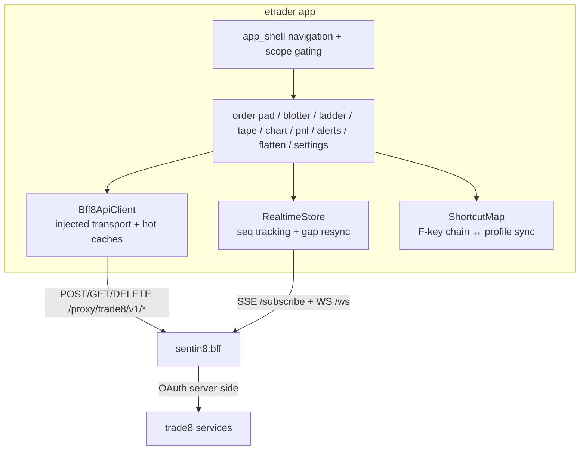

# etrader - Trade8 Professional Trading App

> Audience: developers working on the app; product overview in
> `BUSINESS.md`. App design: `design/sentin8-trade8-apps-technical-design.md`.

## 1. Summary

etrader is the trade8 vertical's Flutter trader app (web/mobile/desktop),
delivered through the Sentin8 App Store. It is a pure BFF client: every
backend call routes through Sentin8:BFF (`/proxy/trade8/...`, SSE
`/subscribe`, WS `/ws`) - it never calls a trade8 service directly and
holds no tokens.

## 2. Motivation

A professional trading workspace has exacting UX requirements (keyboard
density, sub-second updates, L2 ladders) that must not be balanced by
holding backend credentials in the browser. The BFF pattern gives the app
session-grade transport while the platform keeps OAuth tokens server-side;
the app is therefore stateless about identity and safe on any surface.

## 3. Architecture & High-Level Design

## 4. Key Traits and Data Structures

- **`Bff8ApiClient`** (`bff/bff_client.dart`) - the injected transport
  (`Future<Map>` per call + `Stream<BffEvent>` per channel), DTOs
  (`OrderRow` with the `working` filter, `Quote` with ×10⁴ scaling),
  `BffError`, hot caches (orders/quotes/tape/pnl), and the
  `BffClientScope` InheritedWidget.
- **`RealtimeStore`** (`bff/realtime_store.dart`) - per-topic sequence
  tracking; a gap flips the store to `resyncing` (banner + snapshot
  refetch); a disconnected channel surfaces the banner.
- **Shortcuts** (`bff/shortcuts.dart`) - the F-key trading chain (F1/F2
  limit buy/sell, F3/F4 market, F5 cancel all, F6 flatten, F9 refresh, F10
  focus) synced bidirectionally with the trader's `tool_preferences`.
- **Pages** (`pages/`) - `order_pad` (typeahead, tick-band steppers,
  idempotent client ids), `blotter` (working/terminal filters, cancel),
  `depth_ladder`, `tape`, `chart` (CustomPainter candles) +
  `chart_indicators` (MA/EMA/VWAP), `pnl`, `alerts`, `flatten_sheet` (typed
  strategy params + basket progress), `settings` (shortcuts + keystroke
  audit view).

## 5. Rationale, Trade-offs, and Alternatives

- **Plain StatefulWidgets + InheritedWidget + Streams** - no external state
  package: the app is small, deterministic, and easily testable; the
  realtime layer is channel-shaped, matching the BFF transport.
- **Transport injection** - the concrete authenticated transport comes from
  the platform's `sentin8_flutter` bootstrap; the app tests against a fake
  transport. Rejected: app-owned OAuth (token exposure, platform drift).
- **CustomPainter candles** - zero-dependency charting with interval
  derivation client-side (4h from 1h etc.).
- **Server-synced shortcuts** - the trader's muscle memory follows their
  profile across devices.

## 6. Internal Implementation & Invariants (Private Design)

- The app never constructs backend URLs beyond the `/proxy/trade8/v1/...`
  family; no service hostnames appear in the code.
- Every mutation path is idempotent (client order ids) and scope-gated;
  surface visibility follows the user's scopes.
- The ladder/tape render ×10⁴-scaled values as exact decimals (no float
  math on money).
- The RealtimeStore never fabricates data on gap: it resyncs by refetch.

## 7. Unresolved Questions / Future Designs

- Depth-ladder click-to-trade (clicking a level pre-fills the ticket).
- Office-manager surfaces (cross-trader flatten approval) need a product
  pass together with the flatten strategy UX.
- Imbalance widgets await the feed snapshot endpoint (design open item).

---

**Architecture & Design:** trade8:etrader and its underlying concepts were designed by [Hamid Jahanzad](https://www.linkedin.com/in/hamidjahanzad/).
